<picture><source media="(prefers-color-scheme: dark)" srcset="art/push_swap-dark.svg"><source media="(prefers-color-scheme: light)" srcset="art/push_swap-light.svg"></picture>

Give it a list of integers and it prints the shortest sequence of stack operations it can find that sorts them. Written in C, built at 42.

## How it works

- Every value is replaced by its rank, so the sort only ever deals with `0..N-1`.
- Up to 5 numbers are handled by hand-written cases.
- Anything larger uses a two-phase chunk sort: push everything to stack `b` in chunks so it lands roughly sorted, then pull it back to `a` largest first, always rotating `b` in the cheaper direction.

## Numbers

| Input | Average moves | Worst seen |
|---|---|---|
| 100 random integers | ~660 | ~691 |
| 500 random integers | ~5950 | ~6060 |

## Run

```sh
make
./push_swap 2 1 3 6 5 8
```

Bad input (non-numbers, duplicates, out-of-range values) prints `Error` to stderr.
